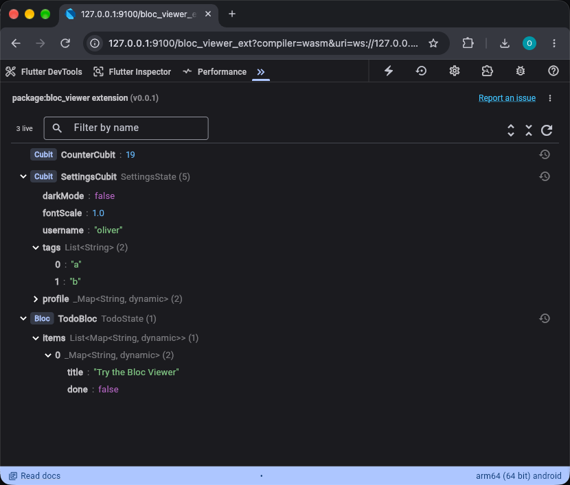
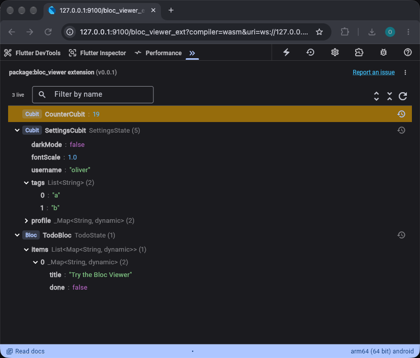
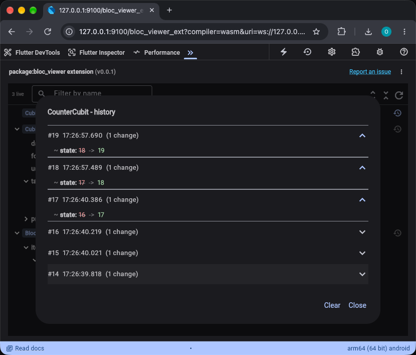
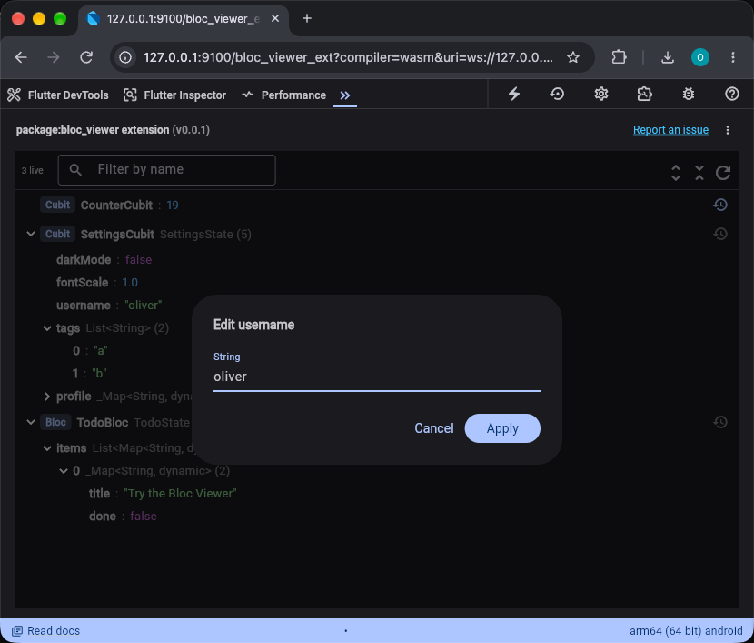

# bloc_viewer

See every live `Cubit` and `Bloc` of your running app in a Flutter DevTools tab:
current state, every change as it happens, and the option to edit values on the fly.



## Features

- **Live tree of all blocs and cubits.** Entries appear when a bloc is created and
  disappear when it is closed.
- **Structured state.** Maps, lists, objects (via `toJson()`, a registered encoder, or
  Equatable `props`), enums and primitives are shown as an expandable tree.
- **Change highlighting.** Changed values flash amber, new nodes green, removed nodes flash
  their parent red. Collapsed ancestors show a soft highlight when a descendant changed.
- **Stable tree.** Updates are merged in place, so expanded/collapsed state and scroll
  position survive state changes. Only the affected row rebuilds.
- **Change history.** Each bloc keeps its last 200 changes with `old -> new` diffs
  (kept until the app restarts).
- **Edit on the fly.** Double-tap a value to change it; the new state is emitted in the
  running app and the UI reacts as to any normal state change.
- **Works with pure Dart.** Only `package:bloc` is required, no Flutter dependency.
- **Zero cost in release.** `BlocViewer.install()` is a no-op in release (product) builds.

| Change highlighting | Change history | Editing a value |
| --- | --- | --- |
|  |  |  |

## Getting started

Add the package (it is only needed while debugging, but `dependencies` works too):

```yaml
dev_dependencies:
  bloc_viewer: ^0.0.2
```

Install it first thing in `main()`, before any bloc is created:

```dart
import 'package:bloc_viewer/bloc_viewer.dart';

void main() {
  BlocViewer.install();
  runApp(const MyApp());
}
```

Run your app in debug or profile mode, open DevTools, click the **Extensions** button
(top right) and enable **bloc_viewer**. A new **bloc_viewer** tab appears.

If DevTools was already open, reload the tab after enabling the extension. Use the
**Refresh** button in the toolbar to re-read all blocs at any time. After a hot restart
the tree reloads automatically.

### Already using a `BlocObserver`?

`install()` sets `Bloc.observer`. Pass your own observer to keep it working:

```dart
BlocViewer.install(delegate: MyObserver());
```

## Editing values

Double-tap a leaf value (`int`, `double`, `bool`, `String` or `null`) in the tree.

| State type | Editable? |
| --- | --- |
| `int`, `double`, `bool`, `String` | Yes, out of the box. |
| Object with `toJson()` or a registered encoder | Shown as fields; editable once a decoder is registered. |
| Object without `toJson()` | Shown via `toString()` or Equatable `props`; read-only. |

To enable editing of object states, register a decoder for the state type:

```dart
BlocViewer.registerDecoder<CounterState>(CounterState.fromJson);
```

The edited JSON is decoded into a new state and emitted. For `freezed`/sealed states,
register the decoder on the bloc type instead: `registerDecoder<MyCubit>(...)`.

For types you do not control, provide an encoder with `BlocViewer.registerEncoder<T>`.

## How it works

A DevTools extension is a separate web app and cannot reach your app's objects, so the
package bridges the two:

1. `BlocViewer.install()` registers a `BlocObserver` that tracks creation, changes and
   closing of every bloc and posts them as events on the VM service.
2. Two service extensions, `ext.bloc_viewer.snapshot` and `ext.bloc_viewer.edit`, let the
   DevTools tab read all current state and apply edits.
3. The compiled extension UI ships inside this package (`extension/devtools/build`), and
   DevTools finds it automatically.

## Limitations

- Very chatty blocs send every event; there is no throttling yet.
- Large states are sent whole on each change (tree depth limit 12, 500 children per container).
- Only leaf values are editable: no adding/removing list or map items, no enum editing.
- State history is lost on hot restart.

## Additional information

See the [`example`](example/main.dart) for a minimal setup. Supports `bloc` 8.x and 9.x.
